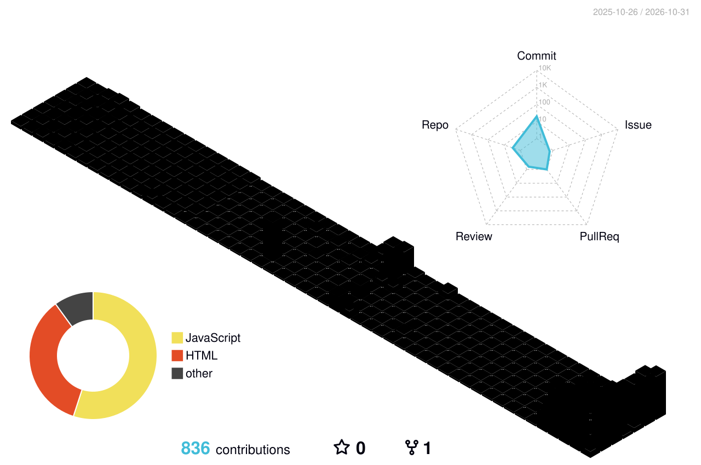

## Hi, I'm Jin 👋

**Full-stack developer building web products for education and decision-making.**  
Civil engineering background · CS @ Curtin & Georgia Tech

I build tools that help people compare universities, prepare for language exams, and explore visa pathways. My current work focuses on product development with Next.js, React, TypeScript, and PostgreSQL, including authentication, content management, payments, and AI-assisted feedback.

### Selected products

Most of my current product repositories are private. Explore the public websites below; source code is not publicly available.

#### [Celmock](https://celmock.com)
A CELPIP preparation platform with timed mock tests, skill-based practice, and AI feedback for writing and speaking.

- Practice workflows covering listening, reading, writing, and speaking.
- Feedback and review tools to help learners identify what to practise next.
- Content management and membership workflows.

`Next.js` `TypeScript` `Payload CMS` `PostgreSQL`

#### [UniRankHub](https://unirankhub.com)
A university comparison platform that brings QS, THE, US News, and ARWU rankings together.

- Compare universities across ranking systems and explore ranking methodologies.
- Adjust ranking criteria to reflect individual priorities.
- Browse university profiles and build a shortlist.

`Next.js` `React` `TypeScript` `Supabase`

### In development

| Project | Focus | Status |
| --- | --- | --- |
| **MET Practice Platform** | Michigan English Test preparation, timed mock tests, and AI-assisted speaking and writing feedback. | In development · Not publicly launched · Private source |
| **VisaDuo** | Visa pathway discovery and comparison, with tools for organising application information. | In development · Not publicly launched · Private source |

### What I work with

- **Web:** TypeScript, JavaScript, React, Next.js
- **Backend & data:** PostgreSQL, Supabase, Payload CMS
- **Product workflows:** Authentication, Stripe payments, content administration, AI-assisted learning tools
- **Additional experience:** C#/.NET, Python/Django, Java/Spring, AWS

### Get in touch

[LinkedIn](https://www.linkedin.com/in/jinhong-zhu) · [Email](mailto:zjhong6666@gmail.com) · [Blog](https://flowers2algernon.github.io/)

Open to software engineering opportunities and technical collaborations.

📈 My GitHub Stats

 
<a href="https://github.com/yoshi389111/github-profile-3d-contrib">
<picture>
  <source media="(prefers-color-scheme: dark)" srcset="https://github.com/Flowers2Algernon/Flowers2Algernon/blob/main/profile-3d-contrib/3d-contrib-profile-night.svg">
  
</picture>
</a>

<a href="https://github.com/ashutosh00710/github-readme-activity-graph">
<picture>
  <source media="(prefers-color-scheme: dark)" srcset="https://github-readme-activity-graph.vercel.app/graph?username=Flowers2Algernon&bg_color=00000f&color=007bff&line=fac539&point=FFFFFF&hide_border=true">
  
</picture>
</a>

<a href="https://github.com/denvercoder1/github-readme-streak-stats">
<picture>
  <source media="(prefers-color-scheme: dark)" srcset="https://github-readme-streak-stats.herokuapp.com?user=Flowers2Algernon&theme=java-dark&hide_border=true&card_width=1000.svg#gh-dark-mode-only">
  
</picture>
</a>

<a href="https://github.com/Flowers2Algernon/github-status">
<picture>
  <source media="(prefers-color-scheme: dark)" srcset="https://raw.githubusercontent.com/Flowers2Algernon/github-status/master/generated/overview.svg#gh-dark-mode-only">
  
</picture>
</a>

<a href="https://github.com/Flowers2Algernon/github-status">
<picture>
  <source media="(prefers-color-scheme: dark)" srcset="https://raw.githubusercontent.com/Flowers2Algernon/github-status/master/generated/languages.svg#gh-dark-mode-only">
  
</picture>
</a>

<b>Note:</b> Top languages is only a metric of the languages my public code consists of and doesn't reflect experience or skill level.
 

:writing_hand: Blog Posts

<!-- BLOG-POST-LIST:START -->
- [Database connection issues when deploying c# to railway](https://flowers2algernon.github.io/posts/Database-Connection-Issues-When-Deploying-C-to-Railway/)
- [2025 年中总结及年尾展望](https://flowers2algernon.github.io/posts/2025-%E5%B9%B4%E4%B8%AD%E6%80%BB%E7%BB%93%E5%8F%8A%E5%B9%B4%E5%B0%BE%E5%B1%95%E6%9C%9B/)
- [Javascript and react basic](https://flowers2algernon.github.io/posts/JavaScript-and-React-Basic/)
- [Network service](https://flowers2algernon.github.io/posts/Network-Service/)
<!-- BLOG-POST-LIST:END -->

<!---
Flowers2Algernon/Flowers2Algernon is a ✨ special ✨ repository because its `README.md` (this file) appears on your GitHub profile.
You can click the Preview link to take a look at your changes.
--->
